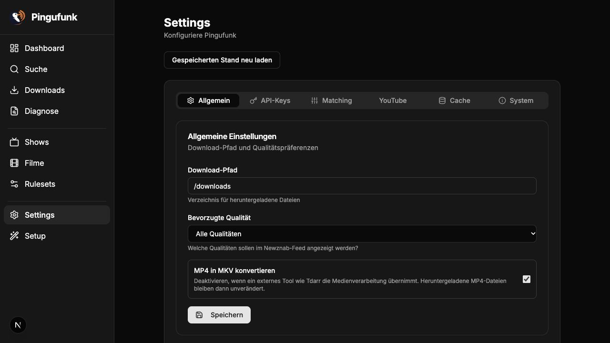

<p align="center">
  
</p>

# Pingufunk

[](https://github.com/superions/pingufunk/actions/workflows/ci.yml)
[](LICENSE)
[](https://github.com/superions/pingufunk/issues)

Rundfunk-Indexer für Sonarr/Radarr - Automatischer Download von ARD, ZDF und anderen deutschen Mediatheken.

> Pingufunk wird eigenständig weiterentwickelt. SQLite und PostgreSQL werden
> gleichwertig unterstützt. Der YouTube-Kanal- und Metadatenkatalog ist in der
> Entwicklung umgesetzt; automatische Programm-/Episodenbindung und der
> vollständige kanonische Zuordnungsbericht sind abgenommen. Die gemeinsame
> YouTube-Such-/Medienintegration wird derzeit nativ geprüft. Entwicklungsabnahme und produktiver Rollout
> sind unterschiedliche Schritte. Siehe [Projektstand](todo/proxy-retirement.md).

## Screenshots

<p align="center">
  
</p>

## Features

- **Newznab-kompatibler Indexer** - Funktioniert mit Prowlarr, NZB Hydra, Sonarr und Radarr
- **SABnzbd-kompatibler Downloader** - Direkter HTTP-Download von den Mediatheken
- **Optionale MKV-Konvertierung** - FFmpeg-Integration mit deutschen Sprachmetadaten
- **Flexible Metadaten-Quellen** - Lokale Datenbank, TVDB oder TMDB
- **Community-Rulesets** - Lokale Rulesets via Pull Request erweiterbar
- **SQLite und PostgreSQL** - Bewusste Backendwahl, versionierte Migrationen und getrennte Bestandsübernahme
- **YouTube-Quellenregister** - Kanäle und Programmzuordnungen per GUI pflegen; zunächst reine Metadatenerfassung

## SRF und ORF über HLS

Aktiviere **HLS-Streams aktivieren** unter Settings → Streaming. Mit
**ORF-Suche aktivieren** werden ORF-Treffer aus MediathekView einbezogen.
Für die SRF-API trägst du Consumer Key und Consumer Secret aus dem
[SRG-SSR-Entwicklerportal](https://developer.srgssr.ch/en/apis/srgssr-video) ein.
Diese Quellen stehen der Websuche und Newznab einschließlich RSS-Sync zur Verfügung.
Die vorhandenen Episodenregeln bestimmen weiterhin, welche Releases Sonarr erhält.

SRF-Videoreferenzen werden erst beim Download durch yt-dlp aufgelöst, einschließlich
der benötigten Stream-Tokens. Ein optionaler Proxy gilt für yt-dlp und Downloads,
jedoch nicht für die SRG-SSR-Metadaten-API. Regionale Beschränkungen hängen weiterhin
vom Proxy-Standort und der Verfügbarkeit beim Sender ab.
Die MKV-Einstellung gilt auch für HLS: aktiviert ergibt MKV, deaktiviert MP4.
Docker enthält eine feste yt-dlp-Version mit Prüfsummenprüfung. Native Installationen
können einen eigenen Programmpfad oder den ebenfalls geprüften automatischen Download nutzen.

## Einstieg

Für eine neue isolierte Quellcodeinstallation: Node.js ab 24, npm und FFmpeg
verwenden. Installation und explizite Datenbankinitialisierung sind im
[Backend-Leitfaden](docs/database-backends.md#lokale-entwicklung-mit-sqlite) beschrieben.
Normale Appstarts initialisieren oder migrieren keine Datenbank.

Die [Compose-Vorlage](docker-compose.yml) baut Pingufunk aus diesem Checkout;
der optionale [PostgreSQL-Override](docker-compose.postgresql.yml) nutzt einen
separaten Secretpfad. Ein neues Containerziel benötigt vorher den passenden
One-shot-Migrator. Veröffentlichte Image- oder Nightly-Tags werden hier nicht
vorausgesetzt. Vor einer Bestandsübernahme gelten die
[SQLite-](docs/sqlite-baseline-transition.md) bzw.
[PostgreSQL-Anleitung](docs/postgresql-migration-runbook.md).

Der Compose-Dienst heißt jetzt `pingufunk`. Bei vorhandenen Compose-Installationen
den alten Dienst vor dem Wechsel geordnet mit seiner bisherigen Konfiguration
stoppen; Datenmounts und die historische SQLite-Datei bleiben erhalten. Details
zu [Marke und Kompatibilität](artwork/README.md).

## Konfiguration

### Umgebungsvariablen

| Variable                   | Beschreibung                                                                      | Standard                           |
| -------------------------- | --------------------------------------------------------------------------------- | ---------------------------------- |
| `PUID`                     | User ID für Dateiberechtigungen                                                   | `1001`                             |
| `PGID`                     | Group ID für Dateiberechtigungen                                                  | `1001`                             |
| `DOWNLOAD_FOLDER_PATH`     | Pfad für fertige Downloads im Container                                           | `/downloads`                       |
| `DOWNLOAD_TEMP_PATH`       | Pfad für laufende Downloads (incomplete)                                          | `$DOWNLOAD_FOLDER_PATH/incomplete` |
| `DATABASE_URL_FILE`        | Absoluter privater Pfad zur gewählten Datenbank-URL; alternativ zu `DATABASE_URL` | nicht gesetzt                      |
| `DATABASE_URL`             | `file:` für SQLite, `postgres:`/`postgresql:` für PostgreSQL                      | bisherige SQLite-Datei             |
| `PINGUFUNK_WRITES_ENABLED` | Expliziter Anwendungsschreibschalter                                              | SQLite `1`, PostgreSQL `0`         |

### Web-Oberfläche

Pingufunk bietet eine vollständige Web-Oberfläche mit:

- **Dashboard** - Übersicht über aktive Downloads und letzte Aktivitäten
- **Suche** - Direkte Suche in den Mediatheken
- **Downloads** - Queue und Historie verwalten
- **Settings** - Alle Einstellungen konfigurieren:
  - Download-Pfad, Qualitäts-Präferenzen und optionale MKV-Konvertierung
  - API Keys für TVDB/TMDB
  - Matching-Strategie und Schwellwerte
  - Cache-TTL Einstellungen
- **Setup-Wizard** - Geführte Erstkonfiguration

### Metadaten-Quellen

Sonarr kann als Metadatenquelle eingebunden werden. Der lokale Katalog ergänzt
bestätigte Zuordnungen; konfigurierte TVDB-/TMDB-Provider bleiben für andere
Episoden verfügbar. Identität und Episodenbindung werden vor einer Freigabe
geprüft. Details im [Metadatenvertrag](docs/sonarr-metadata-contract.md).

## API Endpoints

### Indexer (Newznab)

| Endpoint                                 | Beschreibung          |
| ---------------------------------------- | --------------------- |
| `GET /api/newznab?t=caps`                | Capabilities XML      |
| `GET /api/newznab?t=tvsearch&tvdbid=123` | TV-Suche nach TVDB ID |
| `GET /api/newznab?t=tvsearch&q=Tatort`   | TV-Suche nach Name    |
| `GET /api/newznab?t=search`              | RSS Feed              |

### Downloader (SABnzbd-kompatibel)

| Endpoint                            | Beschreibung        |
| ----------------------------------- | ------------------- |
| `GET /api?mode=version`             | Version             |
| `GET /api?mode=get_config`          | Konfiguration       |
| `GET /api?mode=queue`               | Download-Queue      |
| `GET /api?mode=history`             | Download-Historie   |
| `POST /api?mode=addfile&cat=sonarr` | Download hinzufügen |

## Sonarr/Radarr Einrichtung

### Als Indexer (in Prowlarr oder direkt)

1. Indexer hinzufügen → Generic Newznab
2. URL: `http://pingufunk:6767/api/newznab`
3. API Key: beliebig (wird nicht validiert)

### Als Download Client

1. Download Client hinzufügen → SABnzbd
2. Host: `pingufunk`
3. Port: `6767`
4. API Key: beliebig

Prowlarr synchronisiert nur den Indexer zu Sonarr und Radarr. Richte Pingufunk
als Download Client zusätzlich direkt in jeder \*arr App ein. Ein in Prowlarr
konfigurierter Download Client wird nur für manuelle Downloads aus Prowlarr
verwendet.

## Rulesets & Shows hinzufügen

### Neue Show hinzufügen

1. Show in `data/shows.json` hinzufügen:

```json
{
  "tvdbId": 123456,
  "name": "Show Name",
  "germanName": "Deutscher Name",
  "aliases": [],
  "episodes": [
    { "name": "Episode 1", "seasonNumber": 1, "episodeNumber": 1, "aired": "2024-01-01" }
  ]
}
```

2. Ruleset in `data/rulesets.json` hinzufügen:

```json
{
  "id": 1001,
  "mediaId": 1001,
  "topic": "Mediathek Topic Name",
  "priority": 0,
  "filters": "[{\"attribute\":\"duration\",\"type\":\"GreaterThan\",\"value\":\"30\"}]",
  "titleRegexRules": "[]",
  "episodeRegex": "(?<=E)(\\d{2})(?=\\))",
  "seasonRegex": "(?<=S)(\\d{2})(?=/E)",
  "matchingStrategy": "SeasonAndEpisodeNumber",
  "media": {
    "media_id": 1001,
    "media_name": "Show Name",
    "media_type": "show",
    "media_tvdbId": 123456,
    "media_tmdbId": null,
    "media_imdbId": null
  }
}
```

3. Pull Request erstellen

## Entwicklung

```bash
# Development mit Hot Reload
npm run dev

# TypeScript Check
npx tsc --noEmit

# Lint
npm run lint

# Ausgewählte versionierte Migrationen ausdrücklich anwenden
npm run db:migrate
```

## Projektstruktur

```
src/
├── app/               # Next.js App Router
│   ├── api/           # API Routes
│   │   ├── newznab/   # Indexer API (Newznab)
│   │   ├── settings/  # Settings API
│   │   └── route.ts   # Downloader API (SABnzbd)
│   ├── settings/      # Settings Page
│   ├── setup/         # Setup Wizard
│   ├── search/        # Search Page
│   └── downloads/     # Downloads Page
├── components/        # React Components
│   └── layout/        # Sidebar, Navigation
├── contexts/          # React Context
│   └── settings-context.tsx
├── services/          # Business Logic
│   ├── mediathek.ts   # MediathekView API
│   ├── shows.ts       # Unified Show Lookup
│   ├── tvdb.ts        # TVDB API
│   ├── tmdb.ts        # TMDB API
│   ├── newznab.ts     # RSS/XML Generation
│   └── rulesets.ts    # Matching Rules
├── server/            # Server-Side Only
│   ├── download-manager.ts
│   └── ffmpeg.ts
└── lib/               # Utilities
    ├── db.ts          # Prisma Client
    ├── cache.ts       # Dynamic TTL Caches
    └── settings.ts    # Settings Helper
data/
├── shows.json         # Lokale Show-Datenbank
└── rulesets.json      # Matching Rulesets
```

## Ursprung und Credits

- [RundfunkArr](https://github.com/rundfunkarr/rundfunkarr) – historischer Ursprung; Pingufunk wird eigenständig weiterentwickelt.

- [PCJones/MediathekArr](https://github.com/PCJones/MediathekArr) - Original .NET Implementation
- [MediathekViewWeb](https://github.com/mediathekview/mediathekviewweb) - Mediathek API
- [TheTVDB](https://thetvdb.com) - Metadaten API
- [TMDB](https://www.themoviedb.org) - Metadaten API

## Lizenz

MIT
